# Turnero · Turnos online para negocios

[](https://github.com/acostamatias220/turnero-booking-saas/actions/workflows/ci.yml)


**SaaS multi-tenant de reservas de turnos** para barberías, consultorios, estudios de pilates y cualquier negocio que hoy agenda por WhatsApp. Cada negocio tiene su **página pública de reservas** con su marca, cobra **señas online**, manda **recordatorios automáticos** y gestiona su equipo desde un panel con **agenda diaria por profesional**.

> 🇬🇧 _Multi-tenant appointment-booking SaaS built with Laravel 12, Inertia + React 19 and MySQL. Fail-closed tenant isolation, a timezone/DST-safe slot engine, **database-enforced no-double-booking** (5-minute slot blocks + row locks, proven by a multi-process concurrency test), a Stripe-style signed and idempotent payment webhook flow with hold expiry, queued notifications with `.ics` and signed cancel links, a Sanctum REST API, policies and rate limiting. Pest (200+ tests), Larastan level 8, Pint, Docker and GitHub Actions._

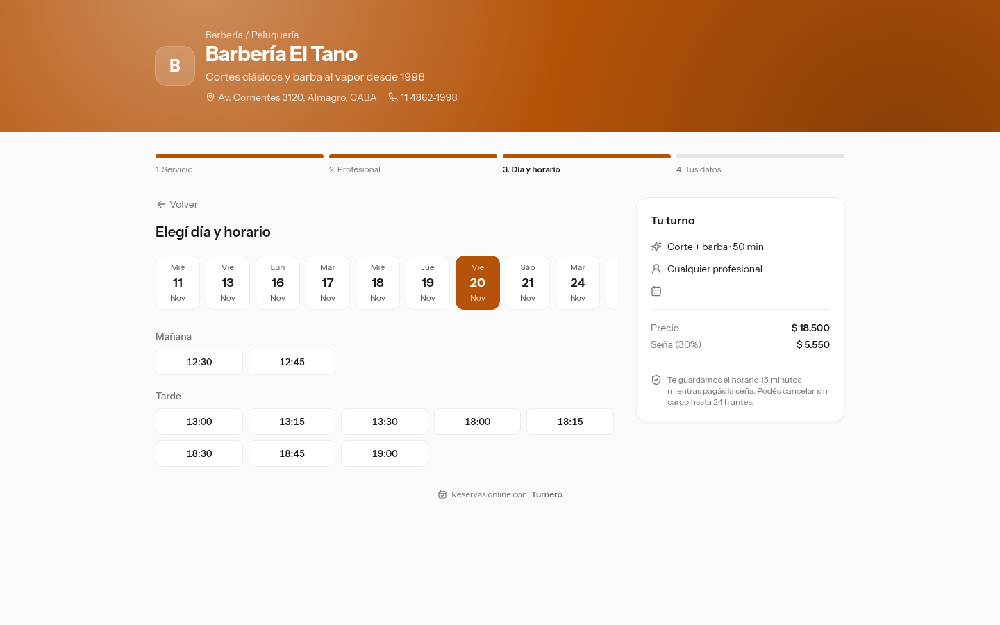

---

##  Funcionalidades

**Para el cliente final** (sin crear cuenta)

- **Reserva en 4 pasos**: servicio → profesional (o _"cualquier profesional"_) → día y horario → datos. Solo se muestran días con lugar y horarios realmente libres.
- **Seña online**: si el negocio pide seña, el horario queda **retenido N minutos** mientras se paga en el checkout del proveedor; si no se paga, se libera solo.
- **Página de estado del turno** que se actualiza sola mientras el pago está pendiente, con **archivo `.ics`** para agregarlo al calendario.
- **E-mails** de confirmación (con `.ics` adjunto), **recordatorio 24 h antes** y cancelación. El link de cancelación está **firmado** y **vence** cuando vence la política de cancelación del negocio.

**Para el negocio**

- **Dashboard** con turnos del día, facturación semanal, ocupación, ausentismo, próximos 7 días (gráfico SVG propio) y servicios más pedidos.
- **Agenda diaria** con una columna por profesional; desde cada turno se marca _atendido_, _ausente_ o se cancela (con reglas de transición de estado).
- **Listado de turnos** con búsqueda, filtros por estado/profesional/fechas y paginado del lado del servidor.
- **Servicios** con duración, **tiempo de preparación/limpieza** entre turnos (buffer), precio y profesionales que lo realizan.
- **Equipo**: horarios por día con **varias franjas** (cortes al mediodía), roles **dueño/a** y **profesional**.
- **Ausencias y feriados**: vacaciones por profesional o cierres del negocio; **importación de feriados nacionales** desde la API pública de ArgentinaDatos.
- **Reglas de reserva**: zona horaria, intervalo de la grilla, anticipación mínima, horizonte, política de cancelación, % de seña, minutos de retención y color de marca.
- **API REST v1** con tokens Sanctum (con _abilities_) para integrar con otros sistemas.

##  Stack

| Capa          | Tecnologías                                                                                                      |
| ------------- | ---------------------------------------------------------------------------------------------------------------- |
| Backend       | PHP 8.3+, Laravel 12, Sanctum, colas (database driver), notificaciones, scheduler, Ziggy                         |
| Frontend      | Inertia 2 + React 19 + TypeScript, Tailwind CSS 4, shadcn/ui, gráficos SVG propios                               |
| Base de datos | MySQL 8.4 (claves compuestas, `UNIQUE` como garantía de negocio, `SELECT … FOR UPDATE`)                          |
| Calidad       | Pest 4 (unit, feature y **concurrencia multi-proceso**), Larastan nivel 8, Pint (`declare(strict_types=1)`), ESLint, Prettier |
| DevOps        | Dockerfile multi-stage (Nginx + PHP-FPM), docker compose (app, worker, scheduler, MySQL, Mailpit), GitHub Actions |

##  Arquitectura

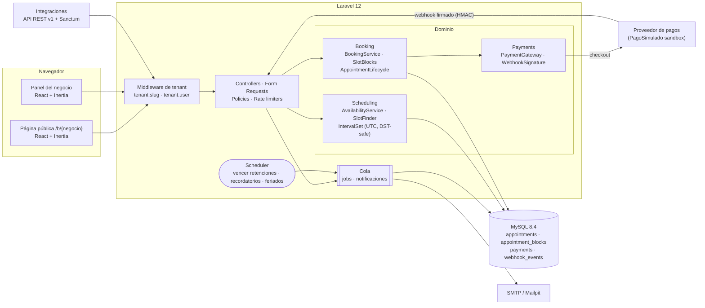

### Flujo de una reserva con seña

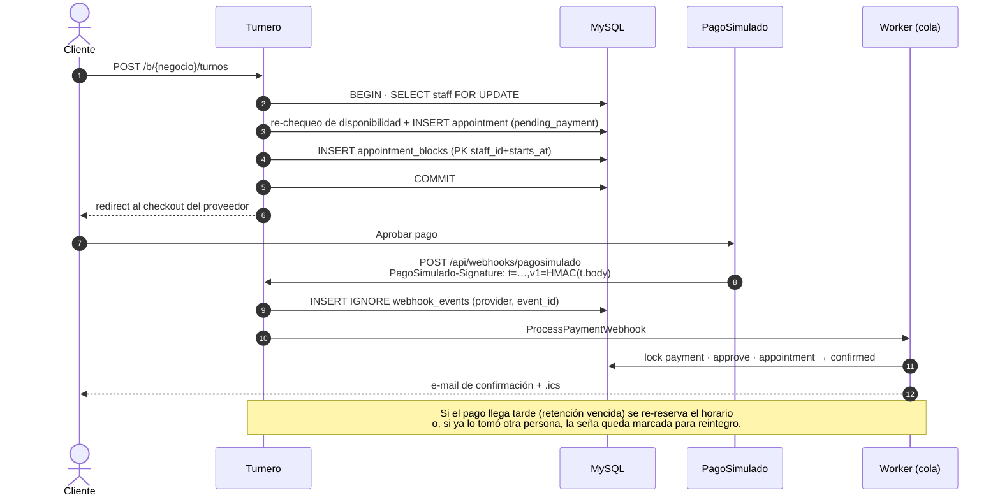

##  Decisiones técnicas

<details open>
<summary><b>1. Aislamiento multi-tenant "fail-closed"</b></summary>

Todos los modelos del negocio usan el trait `BelongsToBusiness`, que agrega un **global scope** que **lanza una excepción si no hay tenant activo** (en lugar de devolver todo). Además completa `business_id` al guardar y **rechaza escrituras cruzadas** entre negocios. La única salida es `Model::acrossTenants()`, explícita y fácil de auditar; un test verifica que `withoutGlobalScope` no aparezca en ningún otro archivo.

El tenant viaja en el payload de cada job encolado y se restaura en el worker. `TenantContext` es una **pila** (push/pop) porque con la cola `sync` un job corre _dentro_ del request y, sin pila, al terminar borraba el tenant del request que lo despachó.
</details>

<details open>
<summary><b>2. Motor de disponibilidad en UTC y a prueba de DST</b></summary>

Los horarios laborales se guardan como hora de pared (`09:00–13:00`, día ISO). Para cada **día calendario** se convierten a instantes UTC usando la zona del negocio, se restan turnos ocupados (incluido el _buffer_), ausencias y feriados con un `IntervalSet` (intervalos semiabiertos), y `SlotFinder` arma la grilla anclada a cada franja. Así un cambio de horario de verano no corre los turnos: está testeado con `America/Santiago`.
</details>

<details open>
<summary><b>3. Cero turnos superpuestos, garantizado por la base</b></summary>

MySQL no tiene _exclusion constraints_ como PostgreSQL, así que la defensa tiene tres capas:

1. **Chequeo de disponibilidad** (UX rápida).
2. **`SELECT … FOR UPDATE` sobre la fila del profesional** como primera lectura de la transacción, y recién después se vuelve a chequear (importante en `REPEATABLE READ`: el snapshot se toma con la primera lectura consistente).
3. **`appointment_blocks`**: cada turno ocupa filas de 5 minutos con `PRIMARY KEY (staff_id, starts_at)`. Aunque algo falle arriba, **la base rechaza la superposición** y se traduce a un `409 Conflict`.

`tests/Concurrency/DoubleBookingTest.php` lanza **8 procesos PHP reales en paralelo** contra el mismo horario: gana exactamente 1 (y con "cualquier profesional", 2 de 8 en un equipo de 2).
</details>

<details open>
<summary><b>4. Webhooks de pago firmados e idempotentes</b></summary>

- Firma estilo Stripe: `PagoSimulado-Signature: t=<timestamp>,v1=<hmac>` con HMAC-SHA256 sobre `t.cuerpo_crudo`, ventana de tolerancia anti-replay, `hash_equals` y aceptación de **varias firmas `v1`** en el mismo header, para que el proveedor pueda rotar el secreto sin cortar el servicio.
- `INSERT IGNORE` en `webhook_events (provider, event_id)` → reintentos del proveedor no procesan dos veces.
- El job bloquea la fila del pago, **nunca degrada un pago aprobado** y maneja el caso feo: **pago aprobado después de que venció la retención** (re-reserva si el horario sigue libre o marca la seña para reintegro).
- El checkout de PagoSimulado es una página aparte que **envía un webhook HTTP real** a la app, así el flujo completo se puede probar localmente.
</details>

<details>
<summary><b>5. Otras decisiones</b></summary>

- **Recordatorios sin duplicados**: el comando "reclama" cada turno con un `UPDATE … WHERE reminder_sent_at IS NULL` atómico antes de encolar el e-mail, así dos schedulers no envían dos veces.
- **Notificaciones `afterCommit`**: nunca se manda un e-mail de un turno cuya transacción terminó en rollback.
- **Links de cancelación firmados** con vencimiento igual al límite de la política de cancelación del negocio.
- **IDs públicos ULID** en las URLs de turnos (no enumerables) y código corto para mostrar al cliente.
- **Rate limiting por IP y por e-mail+negocio** al reservar, honeypot anti-bots, límites separados para disponibilidad, login de API y webhooks.
- **Máquina de estados** explícita (`AppointmentStatus::canTransitionTo`): no se puede marcar "atendido" un turno futuro ni reabrir uno cancelado.
- `Model::shouldBeStrict()` (sin _lazy loading_ silencioso), `CarbonImmutable` en toda la app y `declare(strict_types=1)` en cada archivo.
</details>

##  Estructura

```
app/
├── Tenancy/          # TenantContext, BusinessScope, BelongsToBusiness, middlewares
├── Scheduling/       # Interval, IntervalSet, SlotFinder, AvailabilityService (puro + testeable)
├── Booking/          # BookingService, SlotBlocks, AppointmentLifecycle, BookingCheckout
├── Payments/         # PaymentGateway, PagoSimuladoGateway, WebhookSignature
├── Jobs/             # ProcessPaymentWebhook, DeliverSimulatedWebhook
├── Notifications/    # Confirmación (.ics), recordatorio, cancelación
├── Holidays/         # Cliente de feriados (ArgentinaDatos)
├── Console/Commands/ # expire-holds, send-reminders, holidays:import
├── Http/             # Controllers (Public, Dashboard, Api/V1, Webhooks), Requests, Resources
└── Policies/
resources/js/pages/   # Páginas Inertia (panel, reserva pública, checkout sandbox)
tests/
├── Unit/             # Intervalos, slots, firma de webhooks, dinero, estados
├── Feature/          # Tenancy, disponibilidad, reservas, pagos, API, HTTP, comandos, mails
└── Concurrency/      # Doble reserva con procesos reales
```

##  Cómo correrlo

### Opción A · Local (PHP 8.3+, Composer, Node 20+, MySQL 8)

```bash
git clone https://github.com/acostamatias220/turnero-booking-saas.git && cd turnero-booking-saas
composer install && npm ci
cp .env.example .env && php artisan key:generate
# Crear la base "turnero" y completar DB_USERNAME / DB_PASSWORD en .env
# Para pagos: PAYMENTS_WEBHOOK_SECRET=$(php -r 'echo bin2hex(random_bytes(32));')
php artisan migrate --seed
npm run build

# En tres terminales:
php artisan serve
php artisan queue:work      # webhooks de pago y e-mails
php artisan schedule:work   # vence retenciones y manda recordatorios
```

> `php artisan serve` atiende un request a la vez y el checkout simulado le hace un POST a la propia app: usá `PHP_CLI_SERVER_WORKERS=4 php artisan serve` o la opción con Docker.

### Opción B · Docker

```bash
cp .env.example .env   # completar APP_KEY, DB_PASSWORD y PAYMENTS_WEBHOOK_SECRET
docker compose up -d --build
docker compose exec app php artisan db:seed
```

App en <http://localhost:8080> y bandeja de e-mails (Mailpit) en <http://localhost:8025>.

### Datos de demo

El seeder crea 3 negocios con 30 días de historial y 2 semanas de agenda:

| Negocio                | Página pública              | Seña | Panel (solo demo)              |
| ---------------------- | --------------------------- | ---- | ------------------------------ |
| Barbería El Tano       | `/b/barberia-el-tano`       | 30 % | `tano@turnero.test`            |
| Estudio Pilates Núcleo | `/b/pilates-nucleo`         | —    | `carla@turnero.test`           |
| Consultorio Dra. Ruiz  | `/b/dra-ruiz`               | 50 % | `ruiz@turnero.test`            |

La contraseña de todos los usuarios de demo es `password` (**solo datos de prueba**, nunca en producción).

##  Tests

```bash
php artisan test                       # todo (requiere la base turnero_test)
php artisan test --testsuite=Concurrency
php artisan test --coverage            # requiere pcov o xdebug
vendor/bin/phpstan analyse             # Larastan nivel 8
vendor/bin/pint --test
npx tsc --noEmit && npm run lint && npm run build
```

- **200 tests de Pest (~96 % de cobertura de líneas)** contra **MySQL real** (no SQLite: los locks y los `UNIQUE` son parte del diseño).
- Casos destacados: aislamiento entre negocios (lecturas, escrituras, jobs encolados y binding de rutas), DST, buffers y cortes, retención vencida + pago tardío, firma inválida / vencida / reenviada, idempotencia del webhook, link de cancelación vencido, recordatorios sin duplicar, abilities de tokens y **doble reserva concurrente con 8 procesos**.
- CI corre Pint, Larastan, Pest en PHP 8.3 y 8.4 con MySQL 8.4 (cobertura con pcov) y el build del frontend.

##  Variables de entorno

| Variable                     | Descripción                                                                   |
| ---------------------------- | ----------------------------------------------------------------------------- |
| `APP_KEY`                    | `php artisan key:generate` (nunca se commitea)                                |
| `DB_*`                       | Conexión a MySQL                                                              |
| `PAYMENTS_DRIVER`            | `pagosimulado` (sandbox incluido)                                             |
| `PAYMENTS_WEBHOOK_SECRET`    | Secreto HMAC compartido con el proveedor (vacío = la app se niega a validar webhooks) |
| `PAYMENTS_WEBHOOK_TOLERANCE` | Antigüedad máxima (segundos) de un webhook firmado                            |
| `HOLIDAYS_API_URL`           | Fuente de feriados nacionales (ArgentinaDatos)                                |
| `MAIL_*`, `QUEUE_CONNECTION` | E-mails y cola                                                                |

`.env.example` solo tiene valores de ejemplo; ningún secreto vive en el repositorio.

## 📡 API (resumen)

| Método   | Ruta                                                     | Auth                    | Descripción                                   |
| -------- | -------------------------------------------------------- | ----------------------- | --------------------------------------------- |
| `GET`    | `/api/v1/public/businesses/{slug}`                       | —                       | Negocio, servicios y equipo                   |
| `GET`    | `/api/v1/public/businesses/{slug}/available-dates`       | —                       | Días con lugar (`service_id`, `staff_id?`)    |
| `GET`    | `/api/v1/public/businesses/{slug}/availability`          | —                       | Horarios libres de un día                     |
| `POST`   | `/api/v1/public/businesses/{slug}/appointments`          | —                       | Reservar (`201`, o `409` si se ocupó)         |
| `POST`   | `/api/v1/auth/token`                                     | e-mail + contraseña     | Emite token Sanctum con _abilities_           |
| `DELETE` | `/api/v1/auth/token`                                     | Bearer                  | Revoca el token actual                        |
| `GET`    | `/api/v1/me`                                             | Bearer                  | Usuario y negocio                             |
| `GET`    | `/api/v1/services`                                       | Bearer `services:read`  | Servicios del negocio                         |
| `GET`    | `/api/v1/appointments`                                   | Bearer `appointments:read` | Turnos con filtros y paginado              |
| `GET`    | `/api/v1/appointments/{id}`                              | Bearer `appointments:read` | Detalle                                    |
| `PATCH`  | `/api/v1/appointments/{id}/status`                       | Bearer `appointments:write` | Atendido / ausente / cancelado            |
| `POST`   | `/api/webhooks/pagosimulado`                             | Firma HMAC              | Notificaciones del proveedor de pagos         |

<details>
<summary>Ejemplo</summary>

```bash
curl -s "http://localhost:8000/api/v1/public/businesses/barberia-el-tano/availability?service_id=1&date=2026-11-20"
```

```json
{
  "data": {
    "date": "2026-11-20",
    "timezone": "America/Argentina/Buenos_Aires",
    "slots": [
      { "starts_at": "2026-11-20T15:30:00Z", "ends_at": "2026-11-20T16:00:00Z", "time": "12:30", "staff_ids": [2, 3] }
    ]
  }
}
```
</details>

##  Capturas

| Landing | Checkout del proveedor (sandbox) |
| --- | --- |
| 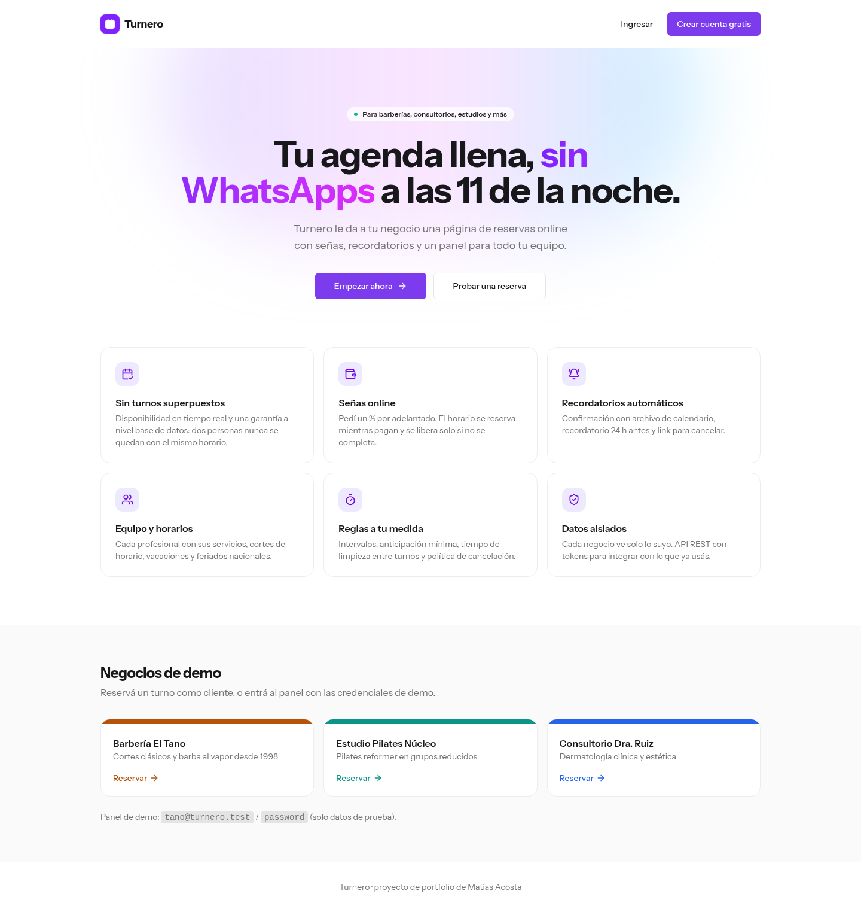 | 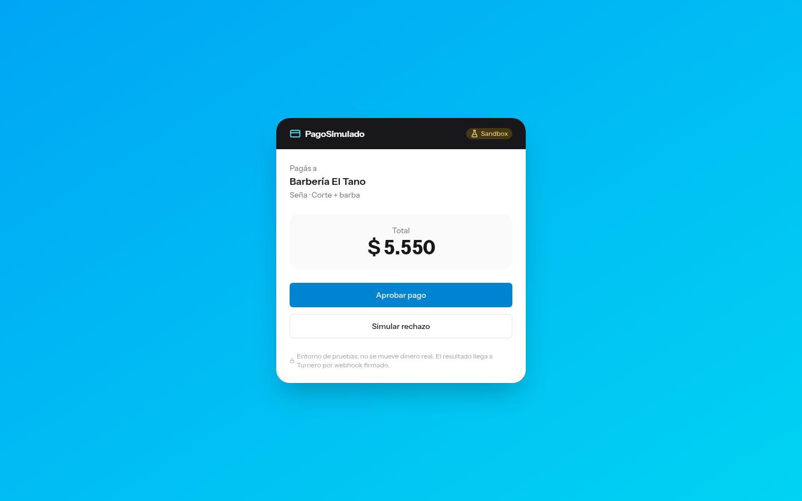 |
| **Datos del cliente** | **Turno confirmado** |
| 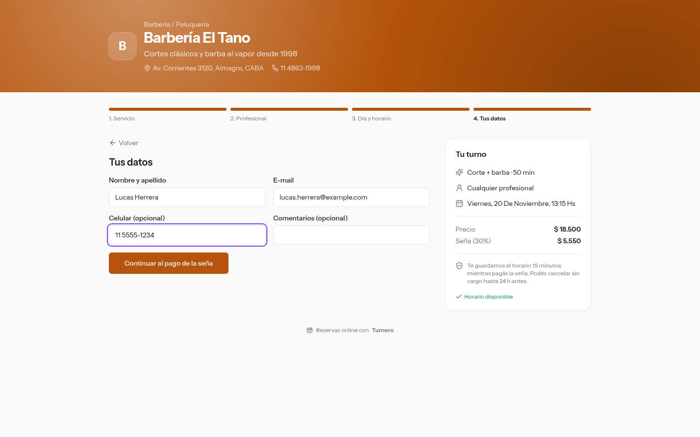 | 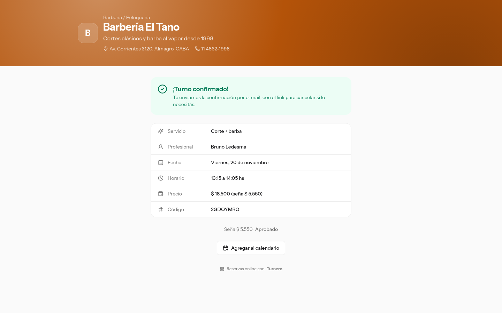 |
| **Dashboard** | **Agenda diaria por profesional** |
| 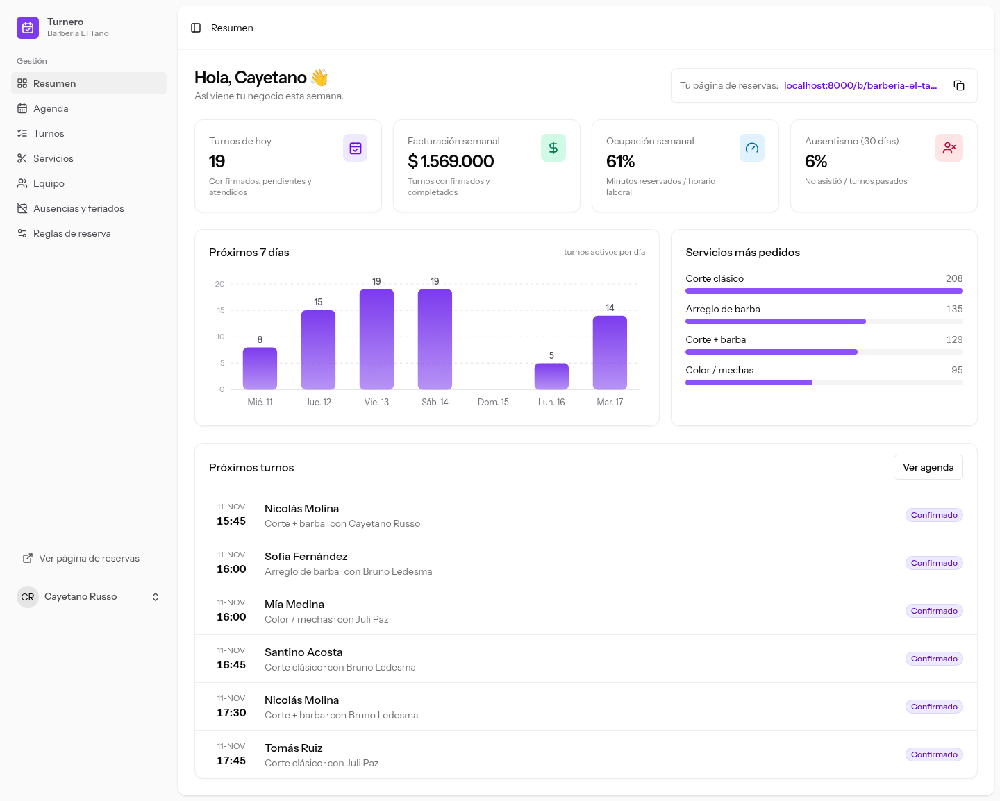 | 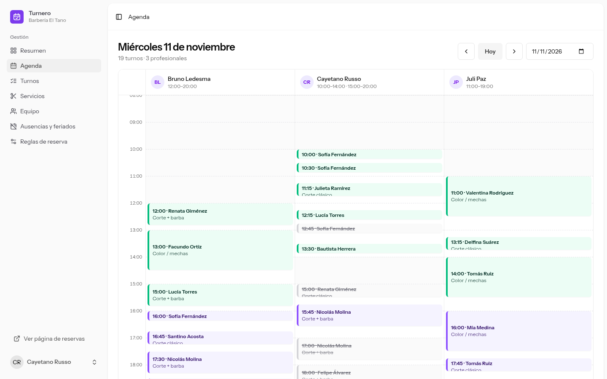 |
| **Detalle del turno** | **Listado con filtros** |
| 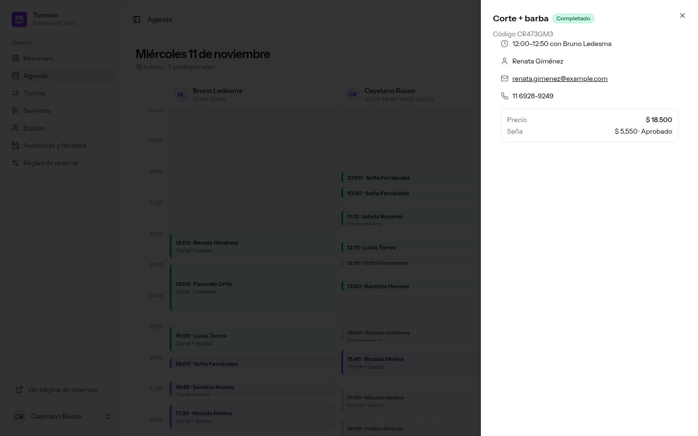 | 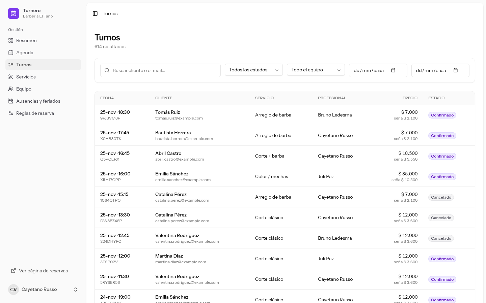 |
| **Equipo: horarios con cortes** | **Reglas de reserva** |
| 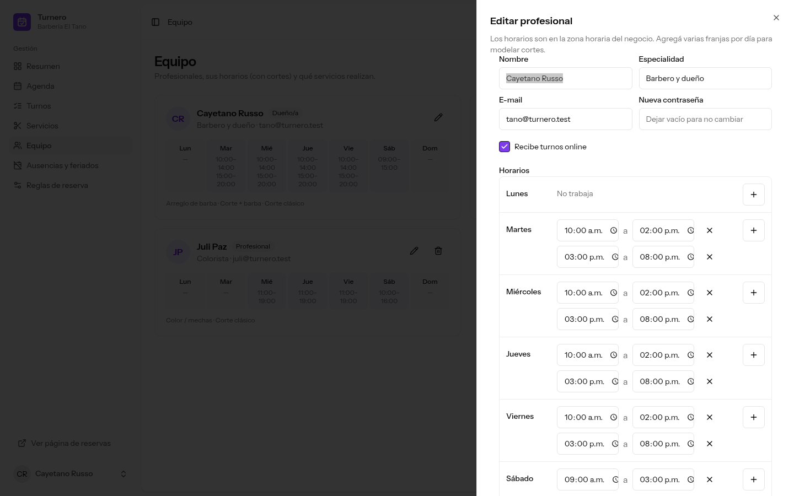 | 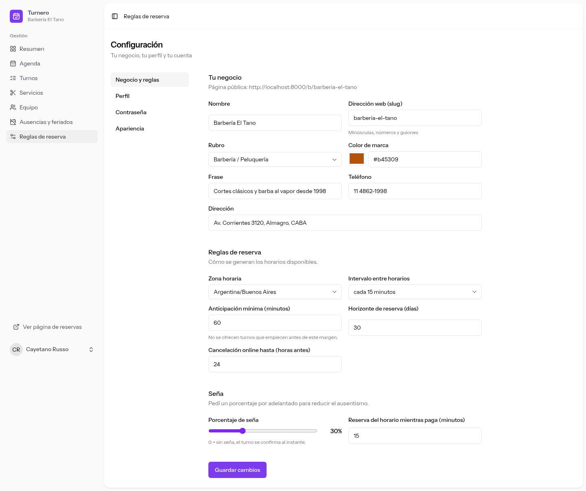 |
| **Servicios** | **Ausencias y feriados** |
| 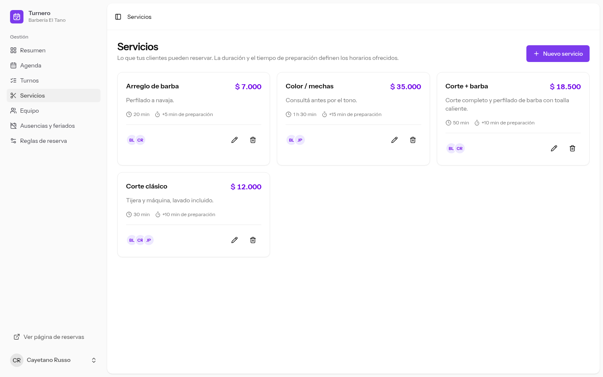 | 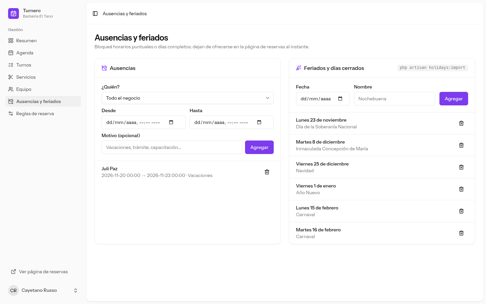 |

<p align="center">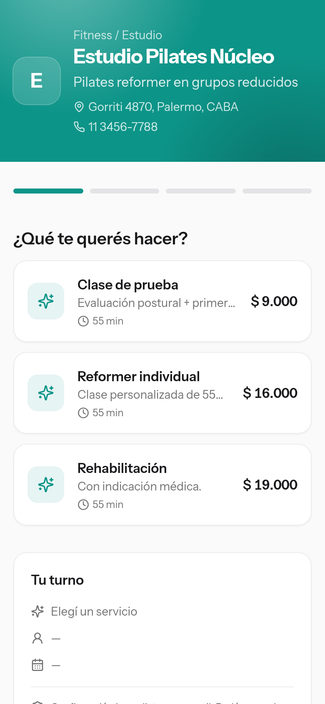</p>

##  Próximos pasos

- Integración real con Mercado Pago (la interfaz `PaymentGateway` ya separa el proveedor).
- Recordatorios por WhatsApp (canal de notificación adicional).
- Turnos recurrentes y clases grupales con cupo.
- Lista de espera que avise cuando se libera un horario.

##  Licencia

[MIT](LICENSE) © Matías Acosta
